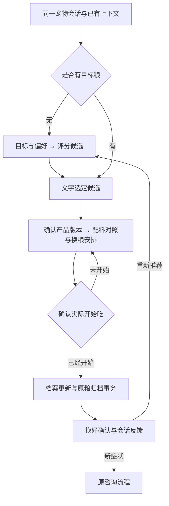

# 管家选粮与换粮流程

2026-10-12，后端 [PR #4](https://github.com/yougurt-cui/chongxi/pull/4) 已合并 main、push 并部署，功能提交 `d58c04a`。年龄选填，以及下面的对话流程已经实现；无需修改小程序代码，通过既有聊天文字和选项完成操作。

## 用户怎么用

1. 说“帮我推荐一款主粮”，补充改善目标和偏好，获得现有引擎评分候选。年龄为空也继续推荐，候选注明适用阶段和“本次未按年龄筛选”。已填年龄时继续匹配阶段。
2. 回复“选第一款”，或“换成品牌和完整粮名”。同名不同版本会返回确认选项，比如猎鸟乳鸽与猎鸟乳鸽 2.0；不会擅自选版本。多候选时说“选这款”会要求明确是哪款。
3. 确认目标后直接展示原粮、目标粮、可用的真实配料，以及逐步引入、保持其他饮食稳定、记录食欲/精神/排便的安排。原粮资料不足时明确说明无法完成双方对比，不推算营养含量或宣称某配料导致症状。本轮没有新增固定换粮比例、天数和喂食量。
4. 仅选中目标、表达计划、回复“还没开始吃”均不更新档案。明确回复“已经开始吃这款”后，后端使用既有档案服务校验产品/配方 ID，以同一事务更新当前粮并归档原粮。重复确认不会重复归档；未知实际开始日期留空。
5. 回复“已经换好了”记录完成；继续说食欲、精神等表现会保存会话反馈。软便等新问题可进入原咨询流程；便血等高风险信号优先中断选粮。说“重新推荐”回到选粮，保留已有历史和咨询上下文。

## 实现与边界

- `guardian_food_flow_service.py` 保存 `_food_flow`：`selection / choose_target / planned / started / completed`；计划和实际喂养明确分开。目标从实时标准目录核验，不能凭客户端任意 ID 保存。
- `miniprogram_chat_service.py` 保留 `food_switch` 外部意图，切换时共享历史与咨询来源。继续换粮不会反复覆盖原粮和换粮原因。目标品牌独立匹配，不用原粮品牌限制目标。
- 原粮已在其他页面更改时阻止旧计划覆盖；档案已保存但会话状态保存失败后的重试可恢复，避免重复写入。
- 目标继续遵守主粮类型、适用阶段、配料与过敏约束；年龄缺失本身不阻止推荐。已有疾病需先结合医生饮食要求。当前产品库为猫粮，未接入狗粮，不用猫粮数据生成狗粮方案。
- 反馈是会话原话和轮次，未新增独立换粮日历、提醒或量化反馈报表。负责人后续详细流程可在这些步骤上继续对齐。
- 旧版小程序通过普通文字和 `text_or_select` 选项消费；新增结构字段可忽略。微信真机与发布版本仍需负责人验收。

## 验证

单元测试覆盖歧义版本、跨品牌、年龄选填、未知 ID、否定/计划/询问不写档案、重复确认、并发档案变化、账号/宠物绑定、犬类/疾病/过敏限制、完成和反馈。

隔离本地 Flask/auth/MySQL smoke 验证推荐 → 选择 → 方案 → 确认 → 档案和历史事务 → 重复确认 → 完成/反馈；旧版小程序源码消费实际 API 响应。测试数据清理，生产不写测试宠物数据。

发布核验：327 个测试、两套隔离 API/MySQL smoke 通过；未修改的旧版小程序消费 24 次聊天返回通过。生产服务重启、公开 HTTPS/鉴权通过；使用已部署代码只读核验年龄为空和 24 月龄均返回 ready、3 个候选，同名版本确认和换粮计划正常，未改真实宠物数据。服务器原有本地修改已保留。需求池第 6 项已同步本次后端范围与接口/流程文档，整条仍进行中，待业务验收及其他剩余工作。
