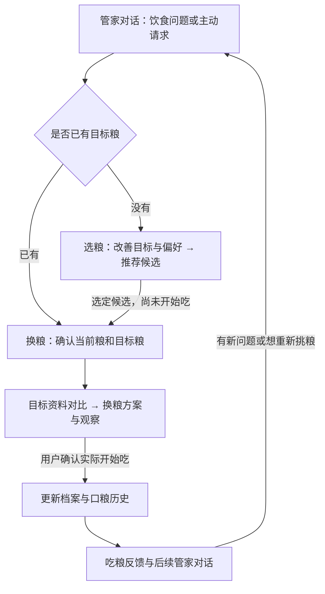

# 选粮、换粮与当前管家的融合

2026-10-12 核对。年龄可选的实现位于 `fix/guardian-optional-age`，尚未合并或部署；下述完整双流程划分是供负责人后续详细流程对齐的方案，不代表都已实现。本次只修改后端年龄筛选和模型说明，不改小程序。

## 本轮年龄调整

年龄为空不再直接排除所有候选，继续结合现有目标画像、当前粮、配料、过敏和明确偏好评分。年龄已填时仍匹配相应适用阶段。缺年龄时保留产品自己的适用阶段，并通过既有 `cautions` 提示“年龄未填写，本次未按年龄筛选”，不猜测宠物年龄或声称年龄适配已验证。

不要求先补年龄才能推荐；资料本身不齐、没有匹配目标或候选等仍可降级。产品类型、配料、评分完整性等原有条件保留。当前具体产品库是猫粮库，狗粮库未接入；本次没有把猫粮候选用于狗。

## 当前已经具备的能力

| 场景 | 已有实现 | 目前的边界 |
| --- | --- | --- |
| 软便后继续选粮 | 最终建议返回 `flow_handoff → food_switch`；文字请求也能切换 | 手机是否显示按钮取决于已发布的小程序版本 |
| 没有目标，想挑一款粮 | `food_switch` 收集当前粮、改善方向和偏好，调用推荐引擎 | 年龄已在本分支改成可选；模型无法代替缺失产品/评分资料 |
| 已有目标，想比较原粮和新粮 | 独立 `/food-change/intent` 能抽取并分别匹配当前、目标产品，读取配料 | 尚未完整接成管家内的独立换粮方案和跟进流程；聊天的 `target_food` 目前主要用于候选筛选 |
| 已经发生换粮，回来反馈 | 软便流程可记录实际饮食变化、原粮/新粮、时间和表现，并比较可用资料 | 与“还在考虑换粮”分开，不能用意向填成实际变化 |
| 确认已开始吃候选粮 | 小程序现有确认动作调用档案 PATCH，后端归档原粮 | 当前确认语义是“已开始吃”，不是“只是选中候选” |

## 建议的接入顺序

选粮解决“挑哪款”，换粮解决“已确定目标后如何比较、执行和跟进”。它们可以共用宠物、饮食与分析上下文，但需要各自的步骤和完成条件。

上图中“选定候选后进入换粮方案”和完整方案/跟进状态仍待负责人细流程确认；现有程序不会自动完成这些步骤。

1. 沿用同一个会话和宠物绑定，复用 `_guardian_context` 里的当前粮、历史原话/云端记录、已确认表现及来源。切换时只问目标流程缺少的信息，不重新问一遍软便背景；年龄不作为两种流程的进入门槛。
2. 没有目标时先选粮；已有明确目标时先确认目标产品/配方，走当前粮与目标粮对比，避免再次问“想选什么粮”或重复推荐一批产品。
3. 用真实产品/配方 ID 与各自品牌关联当前和目标，目标名称模糊时先确认版本；不擅自选择“猎鸟乳鸽”与“猎鸟乳鸽2.0”中的一版。
4. 选中候选只代表计划，保持当前口粮不变。只有用户确认实际开始吃，才使用既有档案 PATCH 与历史事务。实际喂养日期未知时继续留空。
5. 用户描述实际变化后的表现时，将状态交回相应反馈流程；保留新旧粮、计划与实际开始的区别，不把选粮偏好当成已经发生的饮食变化。

负责人详细流程提供后，需要对齐：选粮的必需信息与排序偏好；已有目标时是否跳过推荐；选择候选、开始换粮、完全换好分别如何确认；每阶段记录什么表现、如何恢复中断流程。具体比例/天数不在本轮自行新增。

## 代码接入位置与验证

- 路由/策略：`services/guardian_workflow.py` 的 `FlowStrategy`、`requested_flow`；`services/miniprogram_chat_service.py` 的策略列表、上下文构建及回复。
- 共享上下文：`_share_guardian_context`、`_prepare_food_handoff`。后续双流程应复用来源信息，避免复制两套互不相通的状态。
- 产品推荐：`services/guardian_recommendation_service.py`。
- 原粮/目标粮匹配：`services/miniprogram_food_change_service.py`；实际变化对比工具：`soft_stool_assistant/tools.py`。
- 实际口粮保存：`services/miniprogram_cat_profile_service.py`、`services/miniprogram_diet_history_service.py`。

本分支 309 个测试、两套真实本地 API/MySQL smoke 通过，包含软便 → 历史口粮 → 最终选粮入口 → 偏好 → 推荐 → 用户确认保存；新增年龄为空仍能返回评分候选、原年龄和口粮不被自动更新的检查。旧版小程序消费 18 次真实聊天返回通过。

另外用本分支推荐代码在独立进程中读取生产产品与评分资料，校验年龄为空和 24 月龄均能返回 `ready` 候选；没有修改生产代码或宠物数据。尚未验证完整的双流程方案和小程序真机效果。
